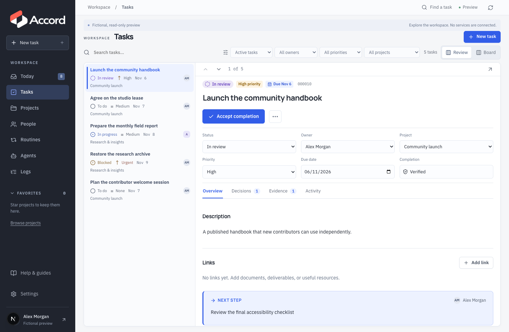
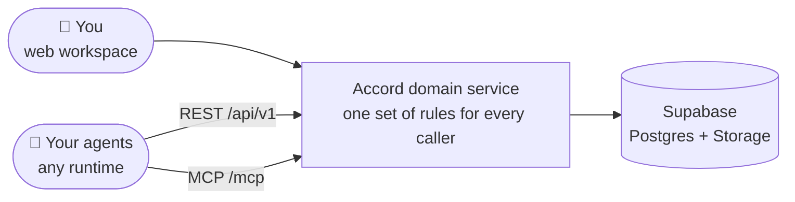

<div align="center">

<picture>
  <source media="(prefers-color-scheme: dark)" srcset="public/brand/accord-logo-dark-v2.webp">
  
</picture>

### Shared work, clearly held.

**A self-hosted workspace for you and your AI agents.**<br>
Projects, tasks, next actions, authority, and evidence — coordinated across one person and their agents.

[](https://github.com/edbarrientos10/accord/actions/workflows/ci.yml)
[](LICENSE)


[Quick start](#-quick-start) · [Features](#-what-you-get) · [Connect an agent](#-connect-an-agent) · [Docs](#-documentation) · [Install](docs/install.md)

</div>

<br>



## Why Accord?

AI agents can now do real work, but the coordination around that work usually lives
in chat logs and scattered tools. **Who owns the next step? What is an agent allowed
to do? How do you know it actually finished?**

Accord gives you one place to answer those questions:

- 🎯 **Clear ownership.** Every task has an outcome, an owner, and an explicit next action.
- 🛡️ **Bounded authority.** Agents propose; you approve, once or as a recurring permission with limits.
- 🧾 **Evidence, not claims.** Closure can require criteria, private evidence, and human acceptance.
- 🔌 **Runtime-independent.** Any agent can connect over REST or MCP. No vendor lock-in, no proprietary coordination service.
- 🏠 **Yours.** Self-hosted on Supabase, with full backups and restore.

## ✨ What you get

|              |                                                                                                              |
| ------------ | ------------------------------------------------------------------------------------------------------------ |
| **Today**    | A focused queue of decisions, approvals, blockers, and overdue follow-ups. Snooze or dismiss.                |
| **Tasks**    | List and board views, priorities, due dates, projects, blockers, and simple or verified completion.          |
| **Projects** | Group tasks, set target dates, and see progress derived from the work itself.                                |
| **People**   | Contacts, interaction history, commitments in both directions, important dates, and stay-in-touch reminders. |
| **Routines** | Visibility into recurring work that runs elsewhere, with deduplicated incidents.                             |
| **Agents**   | Distinct identities with scoped, expiring, revocable tokens.                                                 |
| **Logs**     | Every recorded agent change with actor, action, date filters, and before/after details.                      |
| **Settings** | Owner profile, optional TOTP, scoped exports, complete backups, and restoration.                             |

<details>
<summary><b>Under the hood</b></summary>

- Outcomes, closure criteria, next-action owners, handoffs, blockers, external references, review dates, and attributable history.
- Immutable action revisions, one-time approvals, recurring permissions, atomic usage limits, uncertain executions, and reconciliation.
- Private evidence, human acceptance, explicitly scoped integration verification, criterion-based agent closure, cancellation, and reopening.
- Distinct human/agent/integration identities, scoped expiring tokens, revocation, owner authentication, password recovery, and optional TOTP.
- Recurring-operation visibility and incident deduplication.
- Scoped exports, complete backups, and restoration into an empty installation.

</details>

## 🧭 How it works



The web app, REST API, and MCP endpoint all go through the same domain service, so
people and agents follow exactly the same rules. Accord **records** external execution;
agents perform it in their own runtime.

> [!NOTE]
> Authorization in Accord cannot prevent actions taken through other channels or reverse
> effects in an external system. A declared cost is not verified spending.

## 🚀 Quick start

Try a fictional, read-only preview in under a minute. Requires **Node.js 22** and npm.

```sh
npm ci
ACCORD_DEMO=true npm run dev
```

Open <http://localhost:3000>. The preview contains fictional examples and cannot
authenticate against or change a real workspace.

**Ready for your own workspace?** Follow the [installation guide](docs/install.md) for
local Supabase, or managed Supabase with Vercel. You create the owner with the bootstrap
command; public signup stays disabled.

## 🤖 Connect an agent

Create an agent identity and token in **Agents**, then point any MCP client at your
installation:

| Interface          | Address                    | Purpose                                       |
| ------------------ | -------------------------- | --------------------------------------------- |
| MCP                | `https://YOUR_HOST/mcp`    | Stateless Streamable HTTP with tool discovery |
| REST               | `https://YOUR_HOST/api/v1` | Reads, commands, and evidence upload          |
| Agent discovery    | `/llms.txt`                | Links to current documentation                |
| Consolidated guide | `/llms-full.txt`           | Full text docs for agents                     |

Try it with the bundled example client:

```sh
ACCORD_MCP_URL=https://YOUR_HOST/mcp \
ACCORD_AGENT_TOKEN=accord_... \
npm run agent:example -- query
```

Approvals always happen in **Today**, by the owner, never by the agent. See the
[agent guide](docs/agent-guide.md) for the full operating contract.

## 📚 Documentation

| If you are…                 | Start here                                                                                                                                                       |
| --------------------------- | ---------------------------------------------------------------------------------------------------------------------------------------------------------------- |
| **Using Accord day to day** | [User guide](docs/user-guide.md) · [People](docs/people.md) · [Logs](docs/logs.md) · [Troubleshooting](docs/troubleshooting.md)                                  |
| **Building an agent**       | [Agent guide](docs/agent-guide.md) · [Commands](docs/commands.md) · [API/MCP](docs/api.md) · [OpenAPI](docs/openapi.json) · [Manifest](docs/agent-manifest.json) |
| **Running an installation** | [Install](docs/install.md) · [Backup & recovery](docs/recovery.md) · [Upgrading from the redesign](docs/redesign.md)                                             |
| **Contributing**            | [Architecture](docs/architecture.md) · [Validation status](docs/validation.md) · [Contributing](CONTRIBUTING.md)                                                 |

The app also serves public Help at `/help/index.html`, available before sign-in.
Regenerate docs with `npm run docs:generate` and check freshness with `npm run docs:check`.

## 🧪 Development

```sh
npm run typecheck
npm test
npm run build
npx playwright install chromium
npm run test:e2e
```

PostgreSQL tests run the real migrations in PGlite. MCP tests use real HTTP transport
and a generic client. Browser tests use fictional data and the shared domain service;
they do not prove Supabase Auth or Storage deployment.

## 🚧 Project status

Accord is a **developer preview**, maintained on a best-effort basis. One installation
supports one owner and one workspace. Local checks do not establish hosted readiness;
see [validation status](docs/validation.md). Contributions are welcome — there is no
support SLA or promised release schedule. Please report vulnerabilities as described in
[SECURITY.md](SECURITY.md), and never publish workspace data or secrets.

## 📄 License

Original Accord code and documentation are licensed under [MIT](LICENSE).
The Accord name and logos are covered by a separate [brand policy](TRADEMARKS.md).
Dependencies and fonts keep their [third-party licenses](THIRD_PARTY_NOTICES.md).
